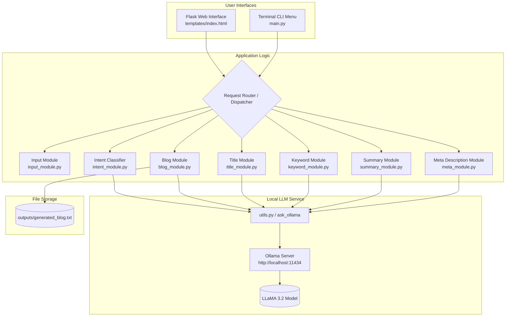

# ✍️ AI Blog Content Generator (gpt2)

[](https://www.python.org/)
[](https://flask.palletsprojects.com/)
[](https://ollama.ai/)
[](LICENSE)

An intelligent, modular **AI Blog & SEO Content Generation Suite** powered by **LLaMA 3.2** running locally via **Ollama**. Create high-ranking, full-length blog posts, SEO-friendly titles, targeted keywords, concise executive summaries, and optimized meta descriptions with zero API costs and 100% data privacy.

---

## 📌 Table of Contents

- [Overview](#-overview)
- [Key Features](#-key-features)
- [System Architecture](#-system-architecture)
- [Repository Structure](#-repository-structure)
- [Prerequisites](#-prerequisites)
- [Installation & Setup](#-installation--setup)
- [Running the Application](#-running-the-application)
  - [1. Web Interface (Flask Dashboard)](#1-web-interface-flask-dashboard)
  - [2. Command-Line Interface (CLI Menu)](#2-command-line-interface-cli-menu)
- [REST API Endpoints](#-rest-api-endpoints)
- [Module Deep Dive](#-module-deep-dive)
- [Configuration & Customization](#-configuration--customization)
- [Troubleshooting](#-troubleshooting)
- [License](#-license)

---

## 🌟 Overview

Content creators, digital marketers, and developers often face friction turning ideas into polished, SEO-optimized articles. **AI Blog Content Generator** automates the entire content production lifecycle from initial concept to publication readiness:

- **Complete Blog Generation**: Generates structured articles with engaging introductions, informative sections, relevant examples, and conclusions tailored to your preferred style, tone, and length.
- **SEO Optimization Suite**: Instantly crafts 5 high-converting headline options, 10 targeted SEO keywords, and a character-bounded meta description (<160 characters).
- **Natural Language Intent Recognition**: Accepts freeform text commands and classifies the user's intent to route tasks automatically.
- **Local & Private**: Runs entirely on your hardware with **Ollama** and **LLaMA 3.2**—no third-party cloud API keys, recurring fees, or data leaks.

---

## 🚀 Key Features

| Capability | Description | Module |
| :--- | :--- | :--- |
| **📝 Long-Form Blog Generation** | Writes structured, human-like blogs based on topic, writing style, tone, and target word count. Automatically saves output to `outputs/generated_blog.txt`. | `blog_module.py` |
| **🎯 SEO Title Generator** | Proposes 5 catchy, click-worthy, and SEO-friendly headlines for any subject. | `title_module.py` |
| **🔑 Keyword Extractor** | Generates 10 high-relevance search keywords to boost Google and search engine rankings. | `keyword_module.py` |
| **📑 Executive Summarizer** | Condenses lengthy articles into a crisp, ~100-word overview ideal for social previews and newsletters. | `summary_module.py` |
| **🏷️ Meta Description Builder** | Generates concise, engaging meta descriptions strictly bounded within the 160-character SEO standard. | `meta_module.py` |
| **🧠 Request Intent Classifier** | Detects intent (`BLOG_GENERATION`, `SUMMARY`, `KEYWORD_GENERATION`, `META_DESCRIPTION`) from plain text requests. | `intent_module.py` |
| **🖥️ Dual Execution Modes** | Run as a full-featured Flask Web Application with an interactive UI or via an interactive Terminal CLI. | `app.py` / `main.py` |

---

## 🏗️ System Architecture



---

## 📂 Repository Structure

```
├── outputs/
│   └── generated_blog.txt       # Auto-saved output of the most recently generated blog
├── static/
│   └── style.css                # Custom CSS styling (optional extension)
├── templates/
│   └── index.html               # Responsive single-page web dashboard
├── app.py                       # Flask server and REST API endpoints
├── main.py                      # Interactive command-line terminal application
├── blog_module.py               # Full blog composition logic
├── input_module.py              # CLI interactive input prompt handler
├── intent_module.py             # User intent classification module
├── keyword_module.py            # SEO keyword generation module
├── meta_module.py               # SEO meta description generator (<160 chars)
├── summary_module.py            # Blog text summarizer (~100 words)
├── title_module.py              # Catchy headline generator (5 options)
├── utils.py                     # Ollama HTTP API connector
├── requirements.txt             # Python dependencies
├── .gitignore                   # Git ignore rules
├── LICENSE                      # MIT Open Source License
└── README.md                    # Project documentation
```

---

## ⚙️ Prerequisites

1. **Python 3.9+** installed on your system.
2. **Ollama**:
   - Download and install Ollama from [ollama.com](https://ollama.com/).
   - Pull the **LLaMA 3.2** model:
     ```bash
     ollama pull llama3.2
     ```
   - Ensure the Ollama background service is running on `http://localhost:11434`.

---

## 📦 Installation & Setup

### 1. Clone the Repository
```bash
git clone https://github.com/rhemiSINGH26/gpt_exp2.git
cd gpt_exp2
```

### 2. Create and Activate a Virtual Environment
- **On Windows (PowerShell):**
  ```powershell
  python -m venv venv
  .\venv\Scripts\Activate.ps1
  ```
- **On macOS / Linux:**
  ```bash
  python3 -m venv venv
  source venv/bin/activate
  ```

### 3. Install Dependencies
```bash
pip install --upgrade pip
pip install -r requirements.txt
```

---

## 🎮 Running the Application

### 1. Web Interface (Flask Dashboard)

Launch the web app:

```bash
python app.py
```

- Open your browser and navigate to: **`http://127.0.0.1:5000`**
- Fill in the topic, writing style, tone, and word count.
- Click **Generate Blog** to create the article.
- Use the quick action buttons to instantly generate titles, extract keywords, produce a 100-word summary, or draft a meta description.

### 2. Command-Line Interface (CLI Menu)

For rapid terminal-based generation:

```bash
python main.py
```

You will see an interactive menu:
```text
========================================
       AI BLOG CONTENT GENERATOR
========================================
1. Generate Blog
2. Generate Titles
3. Generate Keywords
4. Generate Summary
5. Generate Meta Description
6. Detect Intent
7. Exit

Enter your choice: 
```

---

## 🌐 REST API Endpoints

The Flask app (`app.py`) exposes modular JSON REST endpoints:

| Endpoint | Method | Payload (JSON) | Response (JSON) |
| :--- | :--- | :--- | :--- |
| `/` | `GET` | — | Renders web dashboard |
| `/generate_blog` | `POST` | `{"topic": "...", "style": "...", "tone": "...", "word_count": "500"}` | `{"blog": "..."}` |
| `/generate_titles` | `POST` | `{"topic": "..."}` | `{"result": "..."}` |
| `/generate_keywords` | `POST` | `{"blog": "..."}` | `{"result": "..."}` |
| `/generate_summary` | `POST` | `{"blog": "..."}` | `{"result": "..."}` |
| `/generate_meta` | `POST` | `{"blog": "..."}` | `{"result": "...", "length": 154}` |
| `/detect_intent` | `POST` | `{"text": "..."}` | `{"intent": "BLOG_GENERATION"}` |

---

## 🔍 Module Deep Dive

### `blog_module.py`
Prompts LLaMA 3.2 with strict structural constraints:
- Compelling title and hook introduction.
- Logical headings and sub-headings.
- Illustrative examples.
- Strong closing conclusion without disclosing AI origin.

### `intent_module.py`
Provides zero-shot intent categorization:
- Categorizes requests into `BLOG_GENERATION`, `SUMMARY`, `KEYWORD_GENERATION`, `META_DESCRIPTION`, or `UNKNOWN`.
- Enables chatbot workflows and conversational assistants to route incoming requests automatically.

### `meta_module.py`
Forces the LLM to output a concise, conversion-oriented snippet bounded to the 160-character search engine limit for optimal Google SERP display.

---

## 🛠️ Configuration & Customization

- **Change Default LLM Model**:
  To switch models (e.g., `mistral`, `llama3:8b`, `phi3`), update `MODEL` or `"model"` in:
  - `app.py` (Line 9: `MODEL = "llama3.2"`)
  - `utils.py` (Line 8: `"model": "llama3.2"`)
- **Change Ollama Host / Port**:
  If Ollama is hosted remotely or on a custom port, change `http://localhost:11434` in `app.py` and `utils.py`.
- **Change Web Server Port**:
  In `app.py`:
  ```python
  app.run(debug=True, host="127.0.0.1", port=5000)
  ```

---

## ❓ Troubleshooting

| Issue | Cause | Solution |
| :--- | :--- | :--- |
| `Ollama Error: Connection refused` | Ollama service is not running. | Start Ollama with `ollama serve` or open the Ollama desktop app. |
| `Model llama3.2 not found` | The model is not downloaded. | Run `ollama pull llama3.2`. |
| `Request timed out` | Large generation taking longer than timeout. | Increase `timeout=180` in `app.py` or `utils.py`. |
| `Port 5000 already in use` | Another process is occupying port 5000. | Change `port=5000` to `port=5001` at the bottom of `app.py`. |

---

## 📄 License

This project is licensed under the [MIT License](LICENSE).
